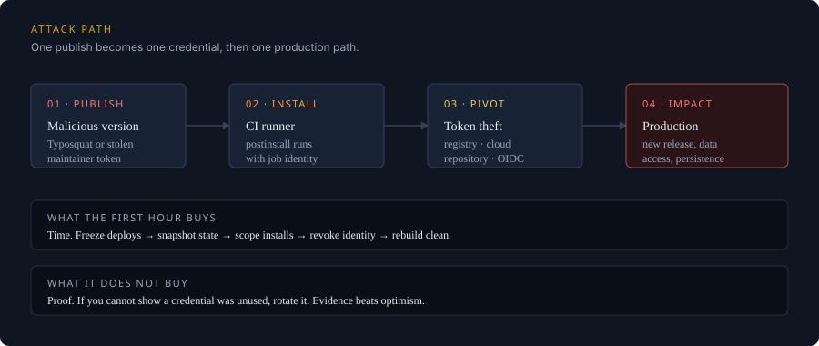

A supply-chain incident is not a vulnerability triage problem. It is an identity problem. The
attacker did not just ship a bad version of a library; they ran code inside your build, with
whatever credentials that build could reach.

That is why the first hour matters more than the first patch. The goal is not to understand
everything. It is to stop the spread, preserve evidence, and make the next rebuild trustworthy.



*Figure 1: The common path is short — one publish, one install, one credential with more reach than the package needed.*

## Minute 0–10: stop the spread

Freeze deploys before you investigate. A pipeline that keeps rebuilding is a pipeline that keeps
installing the compromised version, and every rebuild gives the attacker another chance to use a
token you have not rotated yet.

1. **Pause deployment workflows.** Disable the deploy job or set the environment to require an
   approval you will not grant. Do not delete logs or cancel an in-flight job unless the job is
   actively harmful; the logs are evidence.
2. **Snapshot the state.** Record the lockfile, the resolved dependency tree, the exact runner
   image, and the environment variables that were available to the job (names, not values).
3. **Revoke the highest-reach credentials first.** Registry publish tokens, cloud deploy roles,
   and GitHub App tokens before personal access tokens. A token that can publish a package is
   more dangerous than one that can read a repository.
4. **Open an incident channel and a timeline.** One person owns actions. Every action gets a
   timestamp. This is not bureaucracy; it is how you avoid rotating the same secret twice and
   missing the one that actually leaked.

<aside class="callout callout-warning">
  <p class="callout-title">Do not “just roll back”</p>
  <p>Rolling back the application does not un-steal a token. If the install ran, assume the
  postinstall script executed with the runner's identity. Roll back the deploy, then rotate the
  credentials the runner could use.</p>
</aside>

## Minute 10–30: scope the blast radius

You need three answers: where was the version installed, what did the install have access to, and
what did it leave behind?

### Where was it installed?

Search the dependency graph, not just the direct dependency list. A compromised transitive
package can sit several levels below anything you wrote down.

```bash
# npm: show the resolved tree and why a package is present
npm ls <package-name> --all

# pnpm: inspect the lockfile without installing anything
pnpm why <package-name> --recursive

# Search every lockfile in the org if you do not have a dependency graph
rg -n '"<package-name>"' --glob '**/package-lock.json' --glob '**/pnpm-lock.yaml'
```

For each hit, record the repository, the workflow, the runner, and the date of the last install.
A package that appears only in a developer's local cache is a different incident from one that
ran in a release workflow.

### What could the install reach?

Inventory the job's permissions at the moment of execution. Check the workflow file, the cloud
role assumption, and the repository settings. Common high-reach paths:

| Path | What it gives an attacker | First move |
|---|---|---|
| Registry publish token | A new malicious version under your name | Revoke, audit publishes, notify registry |
| Cloud deploy role | Production compute, secrets, data | Revoke session, review CloudTrail/audit logs |
| GitHub App / PAT | Repository write, workflow edits, releases | Revoke, review audit log, check new keys |
| CI cache credentials | Poisoned artifacts for future builds | Purge caches, rebuild from clean state |
| OIDC trust to cloud | Short-lived but powerful credentials | Remove trust policy, review role sessions |

The last row is the one teams forget. A short-lived credential is still a credential. If the job
could mint one, assume it did.

### What did it leave behind?

Postinstall scripts can persist in more places than the repository: a global cache, a shell
profile, a planted workflow file, a new deploy key, or a modified `package.json` in a package you
publish. Check for unexpected commits, new workflow files, new release assets, and new repository
collaborators.

```bash
# Recent commits touching CI, package metadata, or release configuration
git log --since="7 days ago" --name-only --pretty=format:'%h %ad %an %s' -- \
  .github/ package.json package-lock.json pnpm-lock.yaml
```

## Minute 30–60: contain, rebuild, communicate

Containment is not complete until you can rebuild without the compromised artifact.

- **Purge caches.** Delete CI caches, package-manager caches, and Docker layers that may contain
  the package. A clean install is not clean if it restores a poisoned cache.
- **Pin and verify.** Use exact versions and a lockfile. Enable provenance or signature
  verification where the ecosystem supports it. A lockfile alone is not a security control if the
  registry can be made to serve different bytes for the same version.
- **Rebuild from a known-good commit.** Use a clean runner. Do not reuse a self-hosted runner that
  may have been modified by the install. If you must reuse it, rebuild the runner image first.
- **Rotate in dependency order.** Start with credentials that can create more credentials, then
  move outward: identity provider, cloud, registry, repository, application secrets.
- **Tell the people who need to know.** Your security team, the registry's security contact, and
  any downstream consumers of a package you publish. Do not wait for a perfect timeline. State
  what you know, what you do not know, and when the next update will come.

<aside class="callout callout-tip">
  <p class="callout-title">A useful rule for the first hour</p>
  <p>If you cannot prove a credential was not exposed, treat it as exposed. Rotation is cheaper
  than a second incident that starts from the credential you decided to keep.</p>
</aside>

## What not to do

**Do not run the install again to “see what happens.”** If you need to reproduce, use a disposable
environment with no credentials and no network egress beyond the registry mirror.

**Do not rely on `npm audit` as the scoping tool.** It reports known advisories. A freshly
published malicious package may have no advisory yet. Use the lockfile and build logs.

**Do not treat the incident as closed when the package is removed.** The package is the entry
point, not the incident. The incident is the set of identities that were available after it ran.

**Do not publish a reassuring statement before you have checked the registry.** If your account
published a malicious version, downstream users are affected even if your production was not.

## The first-hour checklist

- [ ] Deploys paused; incident owner and channel named
- [ ] Lockfile, build logs, runner image and environment captured
- [ ] Registry, cloud and repository credentials revoked or rotated
- [ ] Every install location identified from lockfiles and build logs
- [ ] CI and package caches purged
- [ ] Clean rebuild from a known-good commit passes
- [ ] New workflows, deploy keys, collaborators and releases reviewed
- [ ] Registry and downstream consumers notified
- [ ] Timeline and evidence index shared with the response team
- [ ] Follow-up scheduled for provenance, pinning and least-privilege review

## After the first hour

The durable fix is boring: make the build's identity small, make the artifact verifiable, and make
the next incident easier to scope. Pin actions to commit SHAs. Give each workflow the minimum
token permissions. Separate the publish identity from the test identity. Keep a dependency
inventory that does not depend on a single vendor's dashboard.

The first hour is about limiting damage. The next week is about making sure the same path is not
waiting for the next package.
